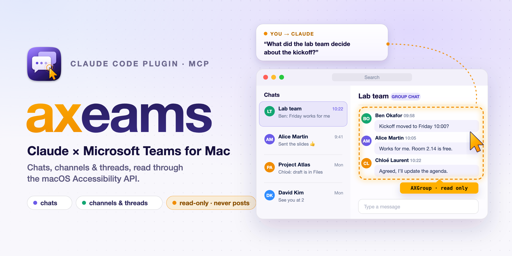

<div align="center">


# axeams-mcp

### Let Claude read Microsoft Teams for Mac: chats, channels and threads, without Graph, tokens or app registrations

[](#-install)
[](https://modelcontextprotocol.io)
[]()
[](#-tools)
[](#-tools)
[](LICENSE)

<br/>



<br/>

**axeams** (**A**ccessibility + T**eams**) is a local MCP server that reads the Teams app you are already signed in to, through the macOS Accessibility API. It works where tenant policy blocks the official Microsoft 365 connectors. Sibling of [axlook-mcp](https://github.com/flol3622/axlook-mcp).

**Read-only by design:** it never posts, replies or reacts.

```text
/plugin marketplace add flol3622/axeams-mcp
/plugin install axeams-mcp@axeams
```

</div>

---

## 🧰 Tools

| Tool | What it does |
| :--- | :--- |
| `teams_status` | Teams running, Accessibility granted, current view |
| `teams_list_chats` | Chats with kind (chat, group, meeting), section, unread flag, last activity, preview |
| `teams_read_chat` | Messages of one chat: author, time, text, attachments, reactions |
| `teams_list_teams` | Teams you belong to |
| `teams_list_channels` | A team's channels by section |
| `teams_read_channel` | Posts with subject, reply count and inline replies |
| `teams_read_thread` | One post with every reply |
| `teams_list_files` | Names in a channel's Shared tab (no contents) |
| `teams_get_conventions` / `teams_set_conventions` | Your personal rules (see below) |
| `teams_ui_snapshot` | Debug dump of the accessibility tree |

Read tools take `older` (scroll back N times) and `limit`.

```
teams_list_teams → teams_list_channels → teams_read_channel → teams_read_thread
teams_list_chats → teams_read_chat
```

---

## 📦 Install

**You need:** macOS 13+, the new Microsoft Teams for Mac (English UI), Node.js 18+ or Bun.

### Claude Code

```text
/plugin marketplace add flol3622/axeams-mcp
/plugin install axeams-mcp@axeams
```

From a local checkout: `/plugin marketplace add /path/to/axeams-mcp`.

### Grant Accessibility (once)

Enable the app that runs Claude (Terminal, iTerm, VS Code, Cursor or Claude) in *System Settings → Privacy & Security → Accessibility*, then restart it. `teams_status` reports `trusted: true` once it works.

### Other MCP clients

```json
{
  "mcpServers": {
    "axeams": { "command": "/bin/sh", "args": ["/Users/YOU/axeams-mcp/scripts/start.sh"] }
  }
}
```

---

## 🧭 Personal conventions

Each user keeps their own rules in `~/.config/axeams/conventions.md` (or `$AXEAMS_CONFIG_DIR`). The server shows them to Claude; the `conventions` skill sets them up. For example, where channel files can be read:

```markdown
# Files
- Channel files are synced under `~/Library/CloudStorage/<cloud folder>`; search there yourself
  (channel libraries appear as "<team> - <channel>").
```

The MCP itself never reads file contents: that stays with Claude's normal file tools, guided by your conventions.

---

## ⚠️ Limitations

- **English UI only.** Labels such as "Message List", "Posts" and "Back to All teams" are matched.
- **Loaded history only.** Teams virtualizes lists; `older` scrolls back to load more.
- **Navigation is visible.** Reading a chat or channel opens it in Teams and marks it read.
- **Not yet:** search, chats not in the visible chat list, hidden channels, subfolders in Shared, Activity feed.
- **Locked screen.** Nothing works while the Mac is locked.

---

## 🛠️ Development

```text
.claude-plugin/       plugin.json (MCP server entry) + marketplace.json
skills/               teams (tool usage) and conventions (personal setup) skills
scripts/start.sh      launcher: picks Node/Bun, checks the helper (rebuilds it from source if needed)
dist/                 shipped build: axeams-mcp.js + axeams-helper (universal, ad-hoc signed)
helper/TeamsAX.swift  generic Accessibility bridge (JSON lines over stdio)
src/                  ax.ts, conventions.ts, teams/{session,parse,chat,channels}.ts, server.ts
assets/               logo.svg, icon.png, hero.svg/png, social-preview.png
test/                 parser and conventions tests (synthetic data)
```

```bash
bun install
bun run build        # dist/axeams-helper and dist/axeams-mcp.js
bun test && bun run typecheck
claude plugin validate . --strict
bun scripts/mcp-call.ts teams_list_chats '{}'   # live call through MCP
```

Verified on Teams 26289 / macOS 27.

## License

MIT
